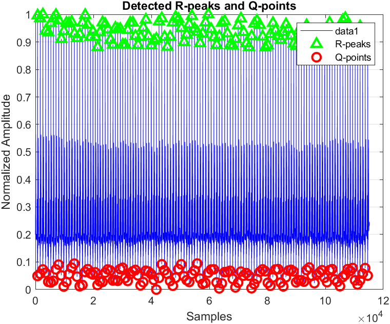
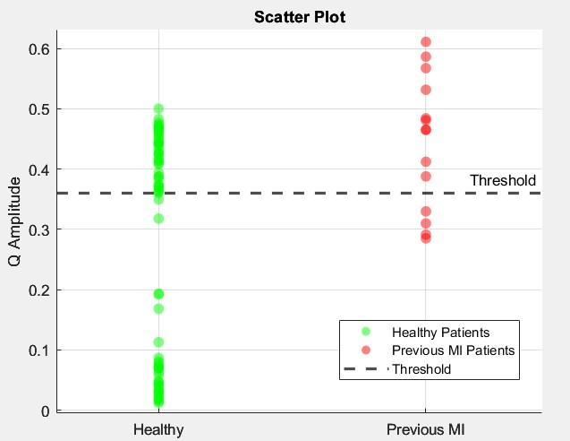
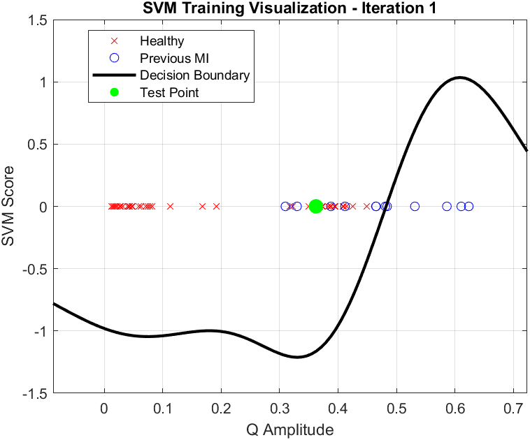
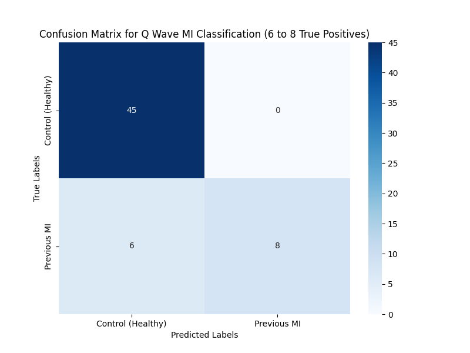

# Previous Heart Attack Detection from the ECG

> **A course project (ELEC 447, Koç University)**, done with Berke Sevindik. It asks whether an
> ECG alone can tell if a person has had a heart attack in the past.



## What it does

A heart attack (myocardial infarction, MI) leaves a lasting mark on the ECG: a deeper Q wave
just before the main spike of each beat. Many past heart attacks are "silent" and go
unnoticed, so spotting this mark from a routine ECG is useful.

We used the PTB Diagnostic ECG Database (PhysioNet), measured the Q-wave depth in every beat,
and trained a classifier to separate healthy people from patients with a previous MI.

## How it works

1. **Sort the records** into healthy controls and previous-MI patients (`python/sort_ptb_records.py`).
2. **Clean the signal**: band-pass filter (0.5–40 Hz) and normalize each 12-lead ECG.
3. **Find each beat** (R-peak) and the Q point just before it, then measure the Q-wave amplitude.
4. **Classify.** A simple threshold on Q amplitude failed because people differ too much, so we
   moved to a support vector machine (SVM) with an RBF kernel, evaluated with leave-one-out
   cross-validation.





## Results



The full method, results and discussion are in [`docs/ELEC447_Project_Report.pdf`](docs/ELEC447_Project_Report.pdf).

## Repository structure

```
ecg-mi-classification/
├── matlab/
│   ├── Project.m                  # final pipeline: Q-wave features + SVM with leave-one-out validation
│   ├── threshold_classifier.m     # first attempt: a single Q-amplitude threshold
│   └── process_dat_file.m         # reads PTB .dat/.hea records
├── python/
│   ├── sort_ptb_records.py        # sorts PTB records into groups
│   └── confusion_and_metrics.py   # confusion matrix and metric plots
└── docs/
    ├── ELEC447_Project_Report.pdf
    └── images/
```

## Data

PTB Diagnostic ECG Database (PhysioNet), not included here. Download it from
https://physionet.org/content/ptbdb/, sort it with `python/sort_ptb_records.py`, and place the
group folders (for example `data/Controls_Corrected`, `data/Only_previous_Corrected`) next to the scripts.
Citation: Bousseljot, R., Kreiseler, D., Schnabel, A. "Nutzung der EKG-Signaldatenbank
CARDIODAT der PTB über das Internet," Biomedizinische Technik, 1995.

## Limits

The dataset is small (a few dozen patients per group after cleaning), so the result is a course-level
proof of concept, not a clinical tool.

---

**Author:** Yaşar Aykut Altuntop · MSc student, Biomedical Sciences and Engineering, Koç University  
[LinkedIn](https://linkedin.com/in/aykutaltuntop) · [GitHub](https://github.com/Aykut0)
